<div align="center">

# NTM IQ Expansion

**The new content of _NTM: IQ Edition_, ported to Minecraft 1.12.2 as an add-on for HBM's Nuclear Tech Mod: Community Edition.**

[](https://www.minecraft.net)
[](https://github.com/CleanroomMC/Cleanroom)
[](https://github.com/Warfactory-Official/Hbm-s-Nuclear-Tech-CE)
[](#requirements)
[](LICENSE)
[](https://github.com/crunkazcanbe/NTM-IQ-Expansion/releases/latest)

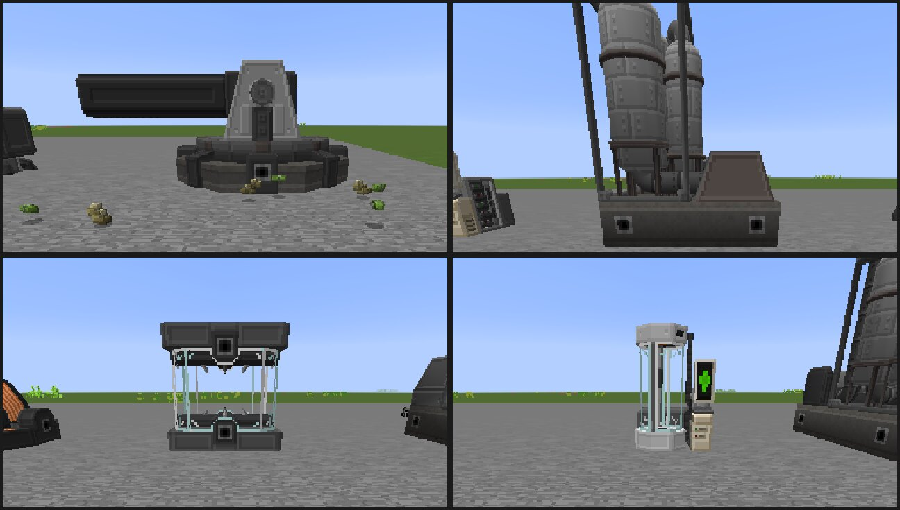

</div>

## About

[NTM: IQ Edition](https://github.com/TrifectumSoftware/Hbm-s-Nuclear-Tech-IQ-Edition) is a 1.7.10 fork of NTM Space
packed with its own ideas: a railgun turret, mining drones, a full bloodstream and disease system, player clones, a
fleshy new nether biome full of glyphids, and a lot more. Its team said plainly that they won't port it to other
versions, so this add-on does: it rebuilds IQ's content on **1.12.2** as a separate jar that runs alongside
**HBM's Nuclear Tech Mod: Community Edition**, the same way NTM Space became an add-on for CE.

Nothing in CE is replaced or patched. The add-on uses **no mixins**: CE's own machines, ores and items keep working
exactly as before, and everything here is added next to them. The textures, models and sounds are the IQ team's
originals.

> This is an **unofficial** port. It is not made by, or affiliated with, the IQ Edition team, the NTM Space authors,
> HBM or the NTM CE team. Please report problems with this add-on [here](https://github.com/crunkazcanbe/NTM-IQ-Expansion/issues),
> not to them.

## Contents

- [Downloads](#downloads)
- [Features](#features)
  - [Materials, ores and building blocks](#materials-ores-and-building-blocks)
  - [Railgun turret "Louis"](#railgun-turret-louis)
  - [Logistics: pipelines, conveyors and magnetic crates](#logistics-pipelines-conveyors-and-magnetic-crates)
  - [Mining drones](#mining-drones)
  - [Machines and chemistry](#machines-and-chemistry)
  - [Bloodstream, drugs and contagion](#bloodstream-drugs-and-contagion)
  - [Husks, cloning and the DIA-1000](#husks-cloning-and-the-dia-1000)
  - [The Nest](#the-nest)
- [Requirements](#requirements)
- [Installation](#installation)
- [Compatibility notes](#compatibility-notes)
- [Commands and key bindings](#commands-and-key-bindings)
- [Configuration](#configuration)
- [What is not ported](#what-is-not-ported)
- [Building from source](#building-from-source)
- [Reporting bugs](#reporting-bugs)
- [Credits](#credits)
- [License](#license)

## Downloads

Get the latest jar from the **[Releases page](https://github.com/crunkazcanbe/NTM-IQ-Expansion/releases/latest)**.
Every release lists its requirements and changes; the full history is in [CHANGELOG.md](CHANGELOG.md).

## Features

### Materials, ores and building blocks

- **New metals:** tin, bronze and vanadium (ingots, nuggets, powders) and soldering alloy.
- **Raw ores:** 24 raw ore items with storage blocks (aluminium, arsenic, australium, beryllium, cadmium, copper, gold,
  iodine, iron, lanthanium, lead, lithium, mineral, morkite, nickel, niobium, palladium, schrabidium, silicon, thorium,
  titanium, tungsten, uranium, zinc). HBM's ores drop raw ore, which smelts as usual and is in the ore dictionary.
- **Resource stone layers:** big 3D-noise blobs of cassiterite and anthracite in the overworld, and rutile, flaming
  anthracite and cobaltite in the nether. CE's own ores are left in place.
- **Fuels:** anthracite and flaming anthracite chunks, hemp coke and haemacoke (with powders and blocks).
- **Decoration:** 34 crystal storage blocks (one for each crystallizer crystal), sheetmetal in 16 colours, and the
  plastic crate.
- **Detail decals:** 16 decal blocks that paint grime onto the solid faces next to them: ash, blood, corrosion, cracks,
  dust, frost, grime, mold, moss, mud, oil, rust, scratches, slime, soot and stains. Each face picks a random variant.
- **Industrial Pipette:** a helmet mod that holds up to 16,000 mB of one HBM fluid. Punch a fluid machine or tank
  with an empty hand to pour into it, or sneak-punch to suck fluid out.

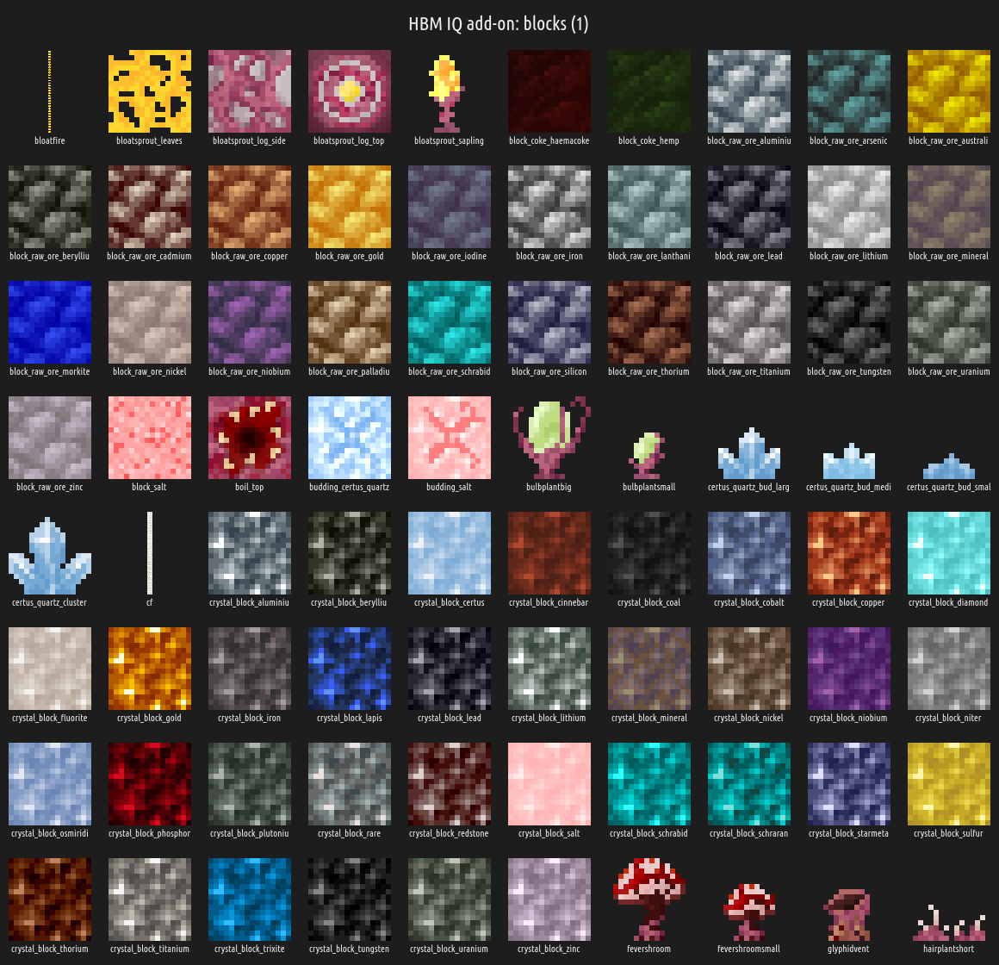

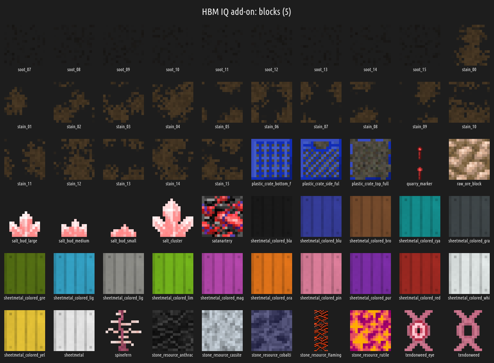

### Railgun turret "Louis"

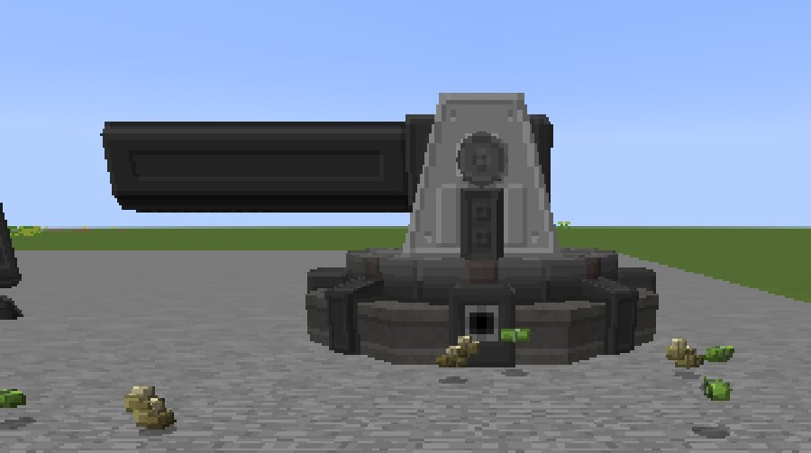

A long-range rail cannon. It charges a 100 MHE firing buffer from a 5 MHE store (250 kHE per tick) and works out the
launch angle for a target X/Z with a linear-drag ballistic model, settling the barrel a step each tick. Set the target
in its GUI or over **Redstone-over-Radio**. It fires six kinds of sabot: **T-APFSDS** (tungsten), **DU-APFSDS**,
**Desh APFSDS**, **Starmetal APFSDS**, **Fluid APFSDS** and the **Nuclear Sabot**. The turret is made in CE's assembler
with IQ's recipes.

### Logistics: pipelines, conveyors and magnetic crates

- **Industrial Pipe Anchor:** pipeline anchors that span up to 100 m, built on CE's pipeline system.
- **Pipe Anchor Pressurizer:** moves fluid in and out of an anchor and runs on compressed air.
- **Conveyor Combinator:** sits on CE's conveyor belts, groups identical items and crafts every full 2x2 or 3x3 set
  into its block.
- **Conveyor Spraypainter:** paints items on the belt with IQ's 16 ink fluids; peroxide bleaches them.
- **Magnetic crates:** a **Magnetic Strip** turns any CE crate magnetic (it stays magnetic when you break and replace
  it). The **Magnetic Crafter** (chestplate mod or held) is a crafting grid that pulls ingredients from magnetic crates
  within 8 blocks. The **Magnetic Stocker** deposits your inventory into them and restocks it from them.

### Mining drones

These work on CE's drone system, its drone crates and waypoints.

- **Quarry Drone + Quarry Marker:** digs out the area inside a marker group, layer by layer in 3x3 patches (32 layers
  deep unless a second marker sets the depth), and flies back to its crate when it is full. Ore blocks are broken
  without drops, because mining ore is the Spelunking Drone's job.
- **Spelunking Drone:** searches nearby caves for exposed ore, flies there through open air, mines only ores into a
  27-slot hold, then returns to its crate.
- **Demolisher Drones** (normal, express, chunkloading, chunkloading express): follow CE waypoints like delivery
  drones, but chew a 3x3 tunnel through anything in their way instead of going around it.

### Machines and chemistry

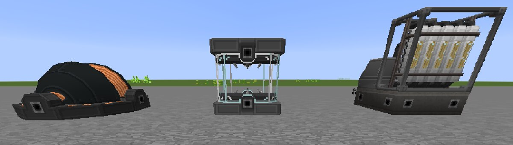

- **94 new fluids** from IQ, registered as CE fluids, with IQ's chemical plant, mixer and electrolyser recipes wherever
  their inputs exist in CE and this add-on.
- **Growth Chamber:** grows salt and certus quartz buds, budding blocks and flowers from a seed item and a fluid.
  **Budding salt** (and **budding certus quartz** when Applied Energistics 2 is installed) grows buds in the world,
  AE2-style. Rare **salt geodes** (basalt shell, salt lining, budding salt) generate underground.
- **Magnetic Separator:** separates items (and, for contagion, genome samples) using magnetic discs of iron, nickel,
  vanadium or neodymium. The disc tier sets how many operations run in parallel, and the disc wears down as it works.
  IQ only had these in creative, so the add-on adds its own survival recipes for the machine and the discs.
- **Mass Centrifuge:** a 5x5 machine that splits heavy sludges, with one 64,000 mB input tank and four output tanks.
- **Construction foam:** spray one of 9 foam fluids from CE's chemical thrower. It sets as soft foam and hardens into
  its material after 10 seconds. **Quikrete** bags (concrete, reinforced concrete, ducrete, reinforced ducrete,
  limestone, netherrack, depthrock, nether depthrock) are mixed and then set in the crystallizer.

<p>
  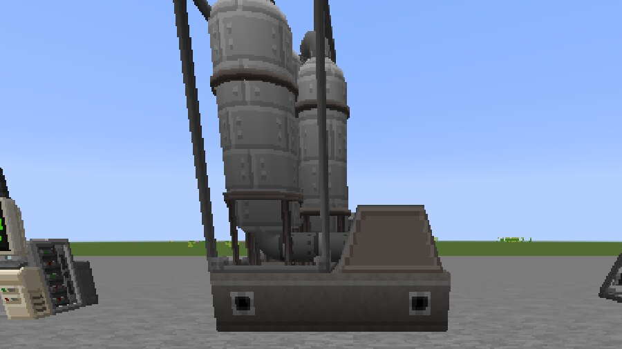
  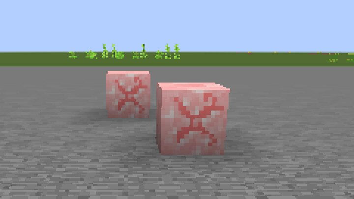
</p>

### Bloodstream, drugs and contagion

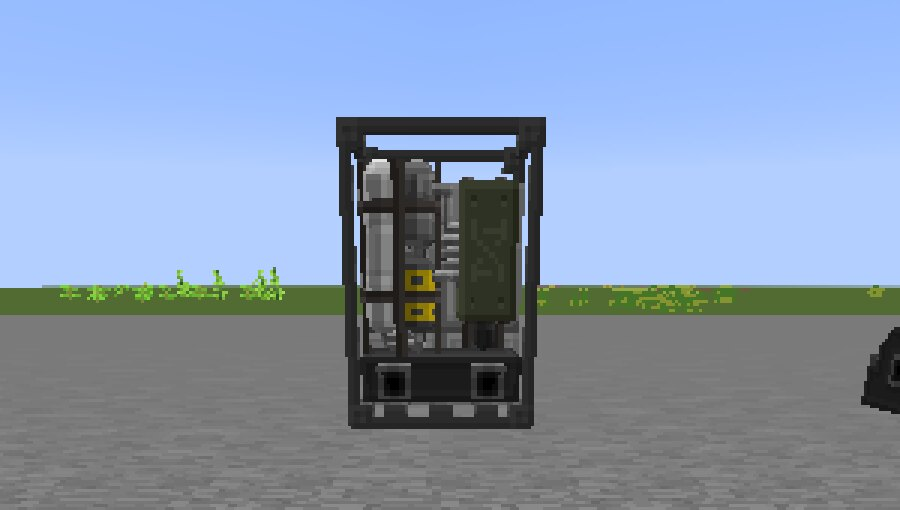

- **Bloodstream:** every living entity has blood that can carry dissolved fluids. Drugs are fluids that decay over
  time, give their effects and can overdose. IQ's drug and symptom potions come with them.
- **Syringes:** fluid syringe, combat syringe, medical syringe and the creative-only Notch syringe. There is also the
  **Auto Drip** (helmet mod that doses you from a stored fluid) and the **Blood Monitor** (leggings mod with a HUD).
  CE's own syringes and RadAway stay as they are.
- **Contagion:** diseases of five kinds, each with a genome that mutates. They spread through the air, by touch, by
  hits, at range, through contaminated items and by needle, and every path can be switched off in the config. A
  carrier stops infecting once enough infected bodies are around it, so an outbreak stays local. **Wild disease
  syringes** can show up in dungeon and mineshaft chests.
- **Fighting it:** sample blood into a **vial**, separate the genome in the Magnetic Separator, write the pieces to a
  **floppy disk**, and brew a matched antiserum in the **Dial-A-Dose medicine synthesizer** with a **Pharmaceutical
  Computing Unit**. Load it with blood instead and it grows the disease rather than curing it. **Rubber** and
  **Desh-lined contagion gloves** protect you from contaminated items.

### Husks, cloning and the DIA-1000

<p>
  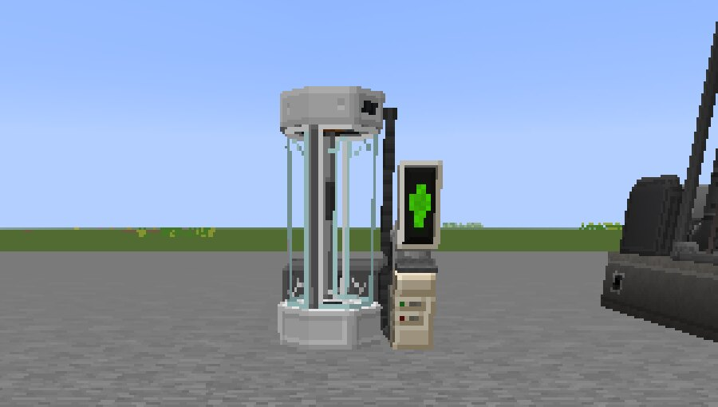
  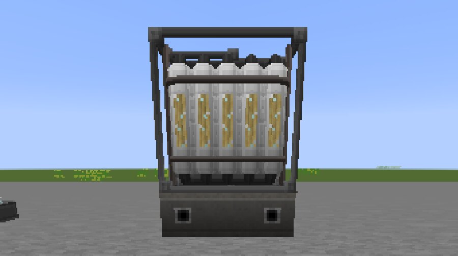
</p>

- **Human parts** (head, torso, arms, legs, heart) each carry five stats and sometimes a trait. Zombies killed by
  players sometimes drop them.
- **Cloner:** load a medical syringe holding a blood sample, one of each human part and a blood fluid. It runs at
  100 HE/t for 100 seconds, then the vat opens and a **husk** of the sample's owner steps out.
- **Neuralyser:** link it to a husk, then swap bodies with it. The **Dead Man's Neuralyser** (chestplate mod) wakes you
  up in your linked husk when you die. The swap was rebuilt to be multiplayer-safe: only the body moves (inventory,
  health, body stats, blood type, position), and every item is always either on you or on the husk.
- **DIA-1000 haemodialysis machine:** a 3x3 machine with three input and two output tanks of 24,000 mB each. It cleans
  The Nest's bloods.

### The Nest

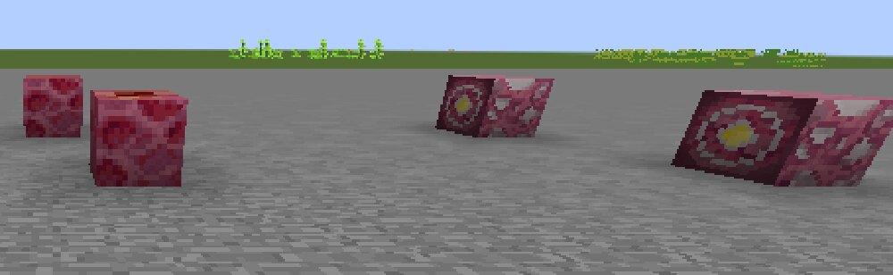

IQ's nether rework, as a new biome. IQ replaces the whole nether world provider; this port **never** does. With
**Nether-API** installed, The Nest is a real nether biome. Without it, random 8x8-chunk regions of the nether become
The Nest, and F3, mob spawning and other mods see the biome.

- **Flesh plants and blocks:** tendonweed and peeping tendonweed, bulb plants, fevershrooms, hair plants, lung plants,
  spine ferns, cysts, bloatsprout trees and bloatfire.
- **Satan's Blood bedrock arteries**, tapped with the **Artery Pump**: 1,000 HE for 100 mB every second, infinite like
  bedrock oil, pushing into pipes on every side.
- **Nine nether glyphids:** grunt, scout, bombardier, brawler, digger, blaster, behemoth, Brenda and Big Man Johnson,
  with nether hives, bloatwisp nests and hive spawners. They are fire-immune and drop netherglyphid meat. The scout withers what it hits. The brawler shrugs off explosions and projectiles and blasts back. The
  behemoth spits burning bloatmusk, the blaster lobs **bloat bombs**, and Brenda dies into a pheromone mist that hatches
  more grunts. Grunts and scouts also turn up rarely in the rest of the nether.

<details>
<summary><b>All items at a glance</b> (labelled icon sheet)</summary>

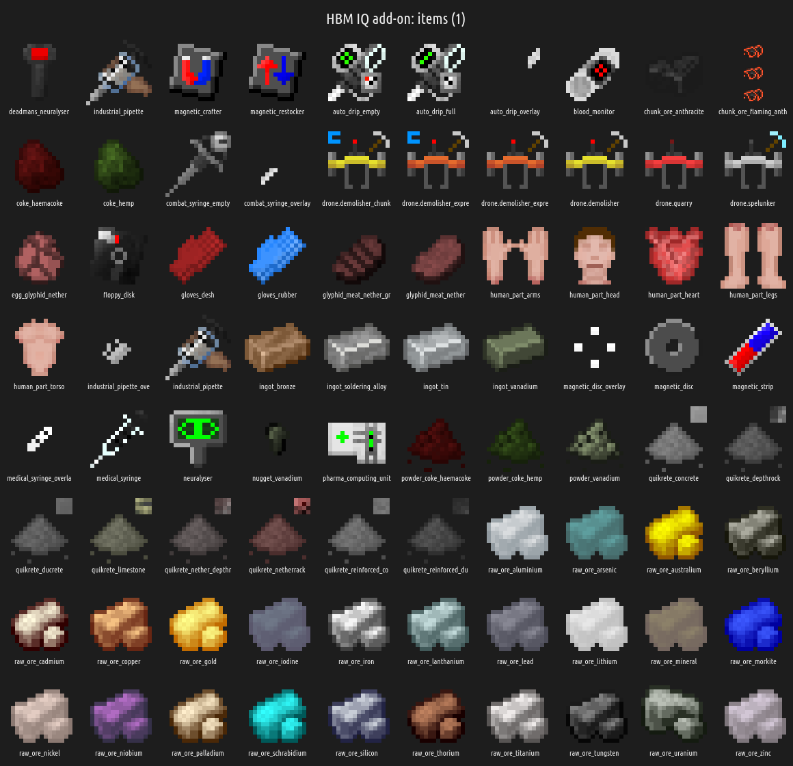

</details>

## Requirements

| | |
|---|---|
| Minecraft | **1.12.2** |
| Loader | **Forge** 14.23.5 or **Cleanroom** |
| Java | 8 (Forge) up to 21/25 (Cleanroom). The jar is Java 8 bytecode. |
| Required | **[HBM's Nuclear Tech Mod: Community Edition](https://github.com/Warfactory-Official/Hbm-s-Nuclear-Tech-CE) 2.5.0.5** and its own dependencies (MixinBooter) |
| Optional | **Applied Energistics 2** (budding certus quartz content), **Nether-API** (The Nest as a real nether biome) |
| Not needed | NTM Space (CE-Space). Space-only IQ content was not ported. |

The add-on is built against CE **2.5.0.5** and uses many of its internals (machines, fluids, drones, turrets, recipes).
Other CE versions may work, but they are not tested.

## Installation

1. Install Minecraft 1.12.2 with Forge or Cleanroom.
2. Put **NTM CE 2.5.0.5** (and its dependencies) in your `mods` folder.
3. Download `NTM-IQ-Expansion-<version>.jar` from [Releases](https://github.com/crunkazcanbe/NTM-IQ-Expansion/releases/latest)
   and put it in the same `mods` folder.
4. Optional: add AE2 and/or Nether-API.
5. On a server, install it on **both** the server and every client.

World generation (stone layers, salt geodes, The Nest, arteries) only happens in **newly generated chunks**.

## Compatibility notes

- **Pride modpack:** this add-on was made for, and is tested in, the Pride modpack (a large Cleanroom pack with NTM CE,
  NetherEx, Nether-API, Better Nether and Biomes O' Plenty). That is why The Nest is added as a biome instead of
  replacing the nether.
- **Cleanroom / Java 25:** fully supported; this is where it is developed and played. The same jar runs on regular
  Forge with Java 8.
- **Multiblock machines** use CE's dummy-block system, like CE's own machines.
- **NTM Space (CE-Space)** is neither required nor used.

## Commands and key bindings

The add-on adds **no commands**. Everything is done with items, machines and the config files.

Key bindings (change them under *Controls*):

| Key | Action |
|---|---|
| `B` | Open the Magnetic Crafter |
| `M` | Magnetic Stocker: deposit into magnetic crates (sneak = everything except the hotbar) |
| `H` | Magnetic Stocker: restock from magnetic crates |

## Configuration

Config files are created in `config/` on first start.

| File | What it controls |
|---|---|
| `ntmiq-worldgen.cfg` | Stone layers: master switch plus per-layer toggles (cassiterite, anthracite, rutile, flaming anthracite, cobaltite). Salt geodes: on/off, rarity (`saltGeodeChance`, default 1 per 32x32 chunks), min/max height. |
| `ntmiq-nest.cfg` | The Nest: `enable`, biome `weight`, `netherHives`, `arterySpawn` (one artery every n-th Nest chunk), `hellSpawns` (glyphids elsewhere in the nether). |
| `ntmiq-contagion.cfg` | `enableDiseases` master switch, `naturalSpread`, `mobToPlayerSpread`, one switch per spread path (aerosol, touch, hit, proximity, injected, contaminated items), `maxInfectedNearby` (outbreak cap, default 8), `wildDiseaseLoot`. |
| `ntmiq-husks.cfg` | `bodySwap` (neuralyser swaps), `deathSwap` (Dead Man's Neuralyser), `partDropChance` (default 0.02). |

The new machines use CE's recipe system, so their recipes can be edited like CE's in `config/hbmRecipes/`:
`hbmGrowthChamber.json`, `hbmMagneticSeparator.json`, `hbmSludgeProcessor.json` and `hbmHaemodialysis.json`.

## What is not ported

On purpose:

- **Space-only content:** Nanomachine Probe, the Dross moon, the Czechoslowakia planet and the Buurman/buurmium chain.
- **Changes that would need mixins into CE:** meteorite tool tiers, the extra ammo variants, the steam press model,
  and IQ's tooltip renderer and RBMK graphs. The add-on also doesn't remove CE's old syringes or ores, as IQ does.
- **Joke and self-insert items.**

Smaller gaps are listed under *Known limitations* in each [release](https://github.com/crunkazcanbe/NTM-IQ-Expansion/releases).

## Building from source

You need **JDK 25** (the build uses Gradle 9 with RetroFuturaGradle and Jabel; the output is still Java 8 bytecode).

1. Get the compile-only jar `NTM-CE-1.12.2-2.5.0.5.jar` from the official NTM CE releases and put it in `libs/`.
   It is another team's mod, so it is not included here.
2. Build:

   ```sh
   JAVA_HOME=/path/to/jdk-25 ./gradlew build
   ```

3. The jar is in `build/libs/` (use the one without `-dev` or `-sources`).

## Reporting bugs

Please open an issue at **[github.com/crunkazcanbe/NTM-IQ-Expansion/issues](https://github.com/crunkazcanbe/NTM-IQ-Expansion/issues)**
and include:

- the add-on and NTM CE versions, and whether you use Forge or Cleanroom,
- the crash report or `latest.log`,
- what you did, and the other big mods in your pack, especially other nether mods.

Please don't send bugs in this port to the IQ Edition, NTM Space or NTM CE teams.

## Credits

- **NTM: IQ Edition**, by the IQ team: [TrifectumSoftware/Hbm-s-Nuclear-Tech-IQ-Edition](https://github.com/TrifectumSoftware/Hbm-s-Nuclear-Tech-IQ-Edition).
  It is maintained by **irislgtm** (Iris) and based on **tam69**'s iq, with **Siepert123**, **NotMega** (iamnotmega),
  **purpl3xity**, **WoodEXPLOSIVE**, **Alexmaster75** (railgun overhaul) and **megamiku**. Every feature here is their
  design, and the textures, models and sounds are theirs.
- **NTM Space**, by **JameH2** and **MellowArpeggiation**: [JameH2/Hbm-s-Nuclear-Tech-GIT](https://github.com/JameH2/Hbm-s-Nuclear-Tech-GIT).
  IQ Edition is built on it.
- **HBM's Nuclear Tech Mod**, by **HbMinecraft** (Bob, HBMMods) and its many contributors.
- **NTM: Community Edition**, the 1.12.2 version this add-on runs on: [Warfactory-Official/Hbm-s-Nuclear-Tech-CE](https://github.com/Warfactory-Official/Hbm-s-Nuclear-Tech-CE),
  by **MrNorwood**, **TheSlize**, **Movblock**, **EOS**, **Alcater**, **Drillgon200**, HBMMods and the CE contributors.
- **1.12.2 port:** crunkazcanbe. Made with [Claude Code](https://claude.com/claude-code); no new Blockbench models were
  needed because all models are IQ's originals.

## License

**GPL-3.0**. See [LICENSE](LICENSE).

NTM: IQ Edition is licensed under GPL-3.0, and this add-on contains code, textures, models and sounds ported from it,
so it is GPL-3.0 as well. It is a modified port: the 1.7.10 code was rewritten for 1.12.2 and NTM CE. The full source
is in this repository.
